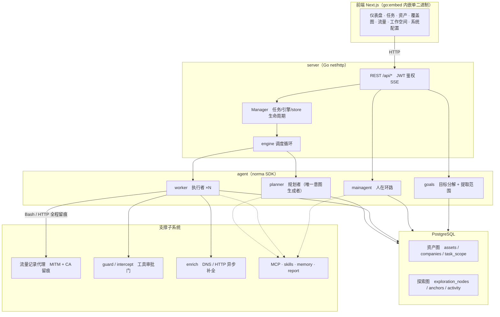
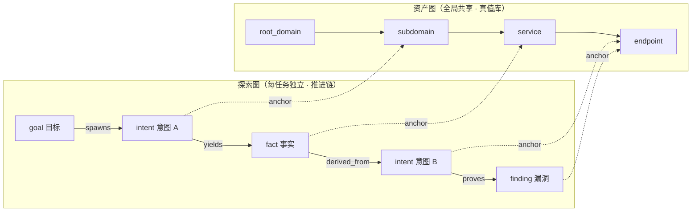
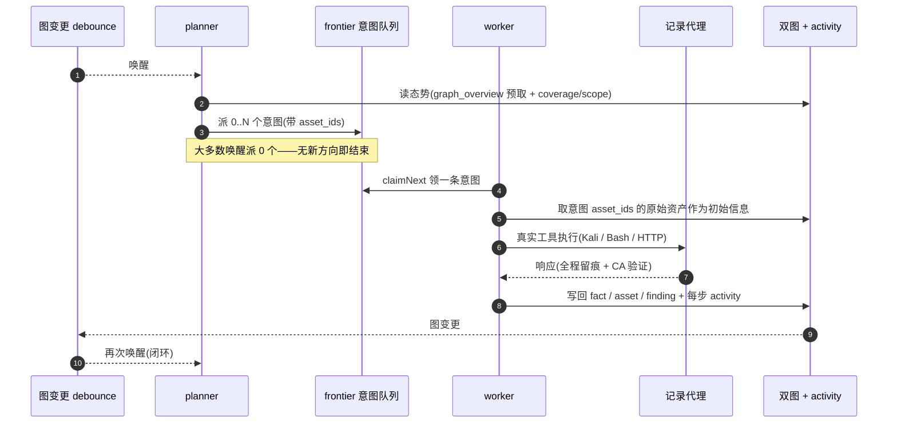
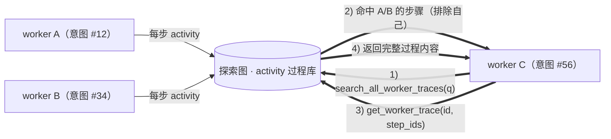
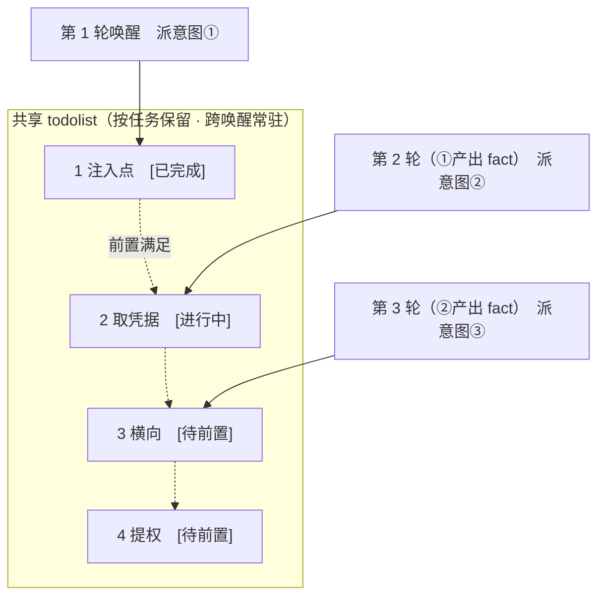

<div align="center">

# BLADEPRO

面向 SRC 漏洞挖掘的 AI 自主审计系统（Go 后端 + Next.js 前端）

**BLADE 的 SRC 分支**：同样是多 agent 自主引擎，但目标函数从「打穿一条链」换成了「把覆盖矩阵的空格清零，并产出可提交件」。

</div>

---

## BLADEPRO 与 BLADE 的区别

两者共用同一套引擎与数据模型（[BLADE](https://github.com/lin9527ya/BLADE) 专做渗透），BLADEPRO 在其上落地了 `mode="src"` 的任务模式。**同一份目标、同样的授权范围，两个仓跑出来的是两种作业方式**：

| 维度 | BLADE（渗透） | BLADEPRO（SRC 挖掘） |
|---|---|---|
| 目标函数 | 证明目标、拿据点、走完攻击链 | 单位时间可提交的有效漏洞数 |
| 规划 | 深度优先，`prove_goal` 驱动收尾 | 广度优先，按「站点 × 风险面」补格 |
| 完成判据 | goals met 即 done | 覆盖格清零 + engine 收尾门复核，模型说了不算 |
| 覆盖表达 | 从意图推导（没派过意图=不显示） | 显式终态 `src_cells`（没行 = 空格的**证据**） |
| 战果取向 | 据点/凭据/持久化（纵深） | 只读证明，到 `whoami`/`id` 即止 |
| 缺口可见性 | 靠人读图判断 | `src_state` / `graph_overview.src` 直接给 `top_gaps` 与 `gaps_by_area` |
| 收尾 | planner 判 met 即落 done | 门被拒 → 注入缺口 → 连续 3 次转 `policy_blocked` 交人工（可人工放行，留痕） |

> 想继续做全链渗透就用 BLADE；要做 SRC 挖洞（广度、可交付、可对账）就用本仓。两者可以并存：同一目标先 BLADE 打深，再用 BLADEPRO 铺面。

## SRC 挖掘模式（`mode="src"`）

创建任务时选 **SRC 挖掘**，或 `POST /api/tasks` 带 `{"mode":"src"}`。模式在创建时定死成快照（`tasks.mode_doc`），运行中不可切换——要换就复制任务。

四层改造，缺一不可（只改提示词是压不住 planner 的）：

1. **规划层**：`graph_overview` 多一个 `src` 块（`gaps_total` / `gaps_by_area` / 前 10 条 `top_gaps` / `focus_asset`）；planner 的核心目标从「打深」换成「补格」，`gaps_total > 0` 时不得 `prove_goal`。
2. **判定层（面）**：`src_cells` 存**显式终态**，只存终态不预填行（空格靠计算，避免行数爆炸）。
   - `tested_found` 必须挂 `finding_id`；
   - `tested_clear` 必须给证据节点或写清说明；
   - `na` 必须写原因**和理由码**（`na_code`，按风险面白名单：`no_input` / `no_exec_sink` / `no_login_entry` …），`budget_stop` 必须写原因；
   - 同一格尝试次数超上限只能用 `budget_stop` 收口。
3. **判定层（收尾闸）**：`src_checks` 回答"测够没有"——JS 抽全 / 路径枚举 / 非 404 复测 / 方法矩阵 / 参数变体 / 防护对照 / 判死三条件 / 截图。`done` 必须带达标数字（如 `paths≥200`）与证据节点；平台项目可选 `check_tier=platform`（手工清单替代批量枚举）。
4. **交付层**：显式提交台账（`src_submissions`）+ 证据合规（唯一标识头/包长/签名头截断）+ 标题与报文格式 + 跨任务指纹去重，收尾门一并要求"能交付"；绑定平台项目时导出带【提交信息】块。

### 风险面（area）与必做面

| area | 含义 | 必做该面的资产类型 |
|---|---|---|
| `unauth` | 未授权 / 未认证可达（swagger/actuator/graphql） | app、service、endpoint |
| `authz` | 越权 / IDOR / 批量赋值 | app、service、endpoint |
| `injection` | SQL/NoSQL/SSTI/命令/表达式注入 | app、service、endpoint |
| `xss` `paths` `session` `upload` `logic` | XSS / 敏感路径 / 登录会话 / 上传 / 业务逻辑 | app、service |
| `ssrf` | SSRF | endpoint |
| `host` `takeover` `cred` | 主机暴露 / 子域接管 / 凭证泄露 | ip、root_domain、subdomain |
| `rce` | 反序列化 / 上传 getshell / 依赖 RCE | 全部站点面（矩阵外面照样能报，只是不占格） |

`mode_doc.required_areas` 可按任务收窄或加面；`hard_items`（如 `paths/enum-200`）要求该面必须逐个细分项点终态，而不是一个 `*` 了事。

### agent 工具（仅在 SRC 任务里出现）

| 工具 | 角色 | 作用 |
|---|---|---|
| `src_state` | planner / main | 读完整矩阵、缺口、终态格、提交台账 |
| `src_mark_cell` | worker / planner | 点亮一格，终态语义与证据当场校验 |
| `src_finish_check` | planner | 收尾门只读预检（`finishable`） |
| `src_prepare_submission` | planner / worker / main | 把一条发现准备成可提交件：正文校验 + 证据合规 + 指纹查重 + 落台账 |
| `src_dedupe` | planner / worker / main | 按指纹跨任务查重；`mark`/`clear` 给重复定案 |

它们**不进 tools 表**：`wireTools` 会把 DB 里绑定的工具重新注入，一旦 seed 就会泄漏到非 SRC 任务。

### 交付闭环（P2）

一条发现要走完这条路才算"能交"，缺一环收尾门就会把缺口报出来：

```
report_finding → 绑 proof/verification 流量 → src_prepare_submission（写正文 + 过合规 + 查重）
   → 台账 draft（有问题）/ ready（可提交）→ 人工或 agent 推进 submitted → accepted → paid
```

**证据合规**（`srcmode.CheckCompliance`，结果存 `src_finding_meta.compliance`）：

- 中危及以上必须有 `proof` / `verification` 角色的绑定流量；
- 请求/响应头声明的 `Content-Length` 不得大于实际正文字节数（跳过 chunked / gzip）；
- `x-request-id` / `x-trace-id` / `x-b3-traceid` / `traceparent` 等标识头不得跨步骤重复（同一个请求被贴了两次）；
- 请求主机必须在任务范围内（`root_domain` 支持子域后缀、`ip/cidr` 走网段包含；判定不了的 scope 不诬告越界）；
- 响应不能全空（状态行 + 头 + 体至少一项）。

**正文门**：描述/危害/修复必须写全，出现「待补」「TODO」这类占位符直接拒绝——SRC 平台退稿的头号原因就是正文没写完。

**独立复验**：中危及以上在准备交付件前必须有一次 `verdict=reproduced` 的独立复验（retester 会话，干净上下文，只按原始证据做最小重放）。第一次准备会自动发起并落 `draft`；等结论回来后再准备一次才会 `ready`。`fixed`/`inconclusive` 不会自动重试。program 可用 `require_retest:false` 关闭。

**影响面/定级建议**：`report_finding` 可填 `cwe` / `cvss_vector` / `impact_scope` / `repro_env` / `test_accounts`。服务端按 CVSS 3.1 算 base score，与自报等级不一致时只提示（`severity_agrees=false`），不替你改等级；这些字段会进发现详情与 SRC 报告头部。

**去重**：精确指纹 = 受控漏洞类型 + 归一化端点集合（路径里的对象 ID 折叠为 `{id}`），只在有绑定流量时才有值。跨任务命中会写 `dedupe_of` 并把 `delivery/duplicate` 顶到收尾门上，必须有人定案（台账标 `duplicate` 或 `src_dedupe clear`）才放行。没有流量时用「类型 + 资产 host/路径 + 参数名」算 `d1:` 降级指纹，只作低置信疑似重复提示（`suspects`），**不自动定案**。

**台账状态机**：`draft → ready → submitted → accepted | duplicate | rejected`，`accepted → paid`，任意 → `withdrawn`。`submitted` 必须带 `external_id`（平台编号或提交凭证）；`duplicate` 必须已登记 `dedupe_of`。驳回时填 `verdict_reason`（无法复现/已重复/信息不全/非漏洞/超出范围/其他）——它会聚合进平台项目的历史成绩，并在下次建任务时写进提示词；`accepted` 会自动沉淀打法卡片，`rejected` 给同技术栈同类型的卡片记失败。

> 没有绑定流量的中危发现会一直卡在交付门。这是刻意的：没证据的发现不叫可提交件。要么补绑证据，要么把它推翻（误报/已撤回），要么人工放行收尾。

交付包（`GET /api/tasks/{id}/src-report.zip`）里除每条发现的 md/docx，还带 `提交说明.md`（清单 + 证据门 + 疑似重复 + 台账摘要）与 `submissions.json`（台账快照）。

### 平台项目与看板（P3）

一个 **program** = "某个平台上的某个项目"：范围说明、平台规则、限速/时间窗、等级映射。创建任务时选它，规则在**创建时**编译进本任务的快照——之后改项目不影响已在跑的任务。

| 能力 | 说明 |
|---|---|
| 规则编译 | 禁用手段/敏感写操作 → 并集进探索策略（只能更严，不能更松）；额度取更小值；命令级规则直接追加 |
| 限速 | `rate_limit > 0` 时编译成三条命令级硬规则：禁 `--flood`、禁 `-t/--threads ≥ 50`、禁 `--rate/--min-rate` 超频；同时写进提示词 |
| 时间窗 | `09:00-18:00` 或分段/跨夜（`22:00-02:00`）；校验并进入提示词，窗口外不该发起动作 |
| 等级映射 | 内部 critical/high/medium/low → 平台等级（info…critical），准备交付件时写进台账 `platform_level` |
| 必做面 | 项目可覆盖"资产类型 → 必做面"，平台要求测什么就测什么 |
| 看板 | `GET /api/src/stats` 聚合：SRC 任务数、台账按状态/等级、中危+ 发现与报告齐备数 |

界面在侧边栏 **SRC 工作台**：提交台账（全局，可改状态、跳任务）与平台项目（增删改）。

| 方法 | 路径 | 说明 |
|---|---|---|
| `GET` / `POST` | `/api/src/programs` | 项目列表 / 新建 |
| `GET` / `PATCH` / `DELETE` | `/api/src/programs/{id}` | 项目详情 / 更新 / 删除（引用它的任务不受影响） |
| `GET` | `/api/src/stats` | 看板聚合数字 |

> 说明：时间窗目前是**提示词级 + 项目级约束**（平台真实作业窗口通常比任务生命周期长）；真正的硬拦截复用全局作业时间窗（`BLADEPRO_SCOPE_ENFORCEMENT`）。限速的高频开关是硬拦的，但"所有慢速高频"无法在命令层穷举——所以它同时是提示词约束。

### HTTP 面

| 方法 | 路径 | 说明 |
|---|---|---|
| `GET` | `/api/tasks/{id}/src` | `{enabled, summary, gaps, cells, assets(矩阵), submissions, doc}` |
| `POST` | `/api/tasks/{id}/src/cells` | 人工点格/改格（同一套终态校验，人也不能绕过证据要求） |
| `POST` | `/api/tasks/{id}/src/force-finish` | 人工放行收尾，必填 `reason`，落审计 |
| `POST` | `/api/findings/{id}/src-submission` | 准备交付件（与 agent 工具同一实现） |
| `PATCH` | `/api/findings/{id}/src-dedupe` | 重复定案（`dedupe_of: 0` 解除） |
| `GET` | `/api/src/submissions` | 台账列表：`?task_id=&status=&platform=&limit=` |
| `PATCH` | `/api/src/submissions/{id}` | 推进状态机 / 写平台编号、回报、备注 |

非 SRC 任务访问 `/src` 返回 `{enabled:false}`，任务详情页的 SRC tab 据此显示提示而不是空矩阵。

### 设计文档

完整方案（P0–P3、DDL、收尾门伪代码、风险与取舍）见 [docs/SRC挖掘agent改造方案.md](docs/SRC挖掘agent改造方案.md)；本仓已实现 P0（模式骨架）、P1（覆盖矩阵与收尾门）、P2（交付台账/证据合规/跨任务去重）、P3（平台项目与看板）。怎么衡量 SRC 模式值不值得用、回归要盯哪些数，见 [docs/SRC评测口径.md](docs/SRC评测口径.md)。

**与 src-dig 技能的范围约束融合**：本仓的 SRC 口径对齐 `~/.claude/skills/src-dig/`（收尾闸、N/A 语义、安全红线、交付校验）。映射表、数据模型与判定口径见 [docs/src-dig范围约束融合.md](docs/src-dig范围约束融合.md)；字节系/京东系/通用的平台规则 JSON 见 [docs/平台规则模板.md](docs/平台规则模板.md)。

> 状态：融合方案的 F1–F4 已落地（2026-10-23）：收尾闸、N/A 理由码、会话红线命令规则、交付校验与提交块。实现细节与诚实边界见 [融合文档 §11](docs/src-dig范围约束融合.md)。

---

## 截图预览

| 仪表盘（总览 / Token 消耗 / 活动流） | 任务列表 |
| :---: | :---: |
|  |  |

| 任务 · 执行过程（会话 / 工具调用） | 探索链路 |
| :---: | :---: |
|  |  |

| 发现 | 资产 |
| :---: | :---: |
|  |  |

| 资产覆盖图（力导向布局 · 已测高亮 · 节点折叠展开） |
| :---: |
|  |

| 流量录制 | 人在环路对话 |
| :---: | :---: |
|  |  |

| Agent 管理 | LLM 配置 |
| :---: | :---: |
|  |  |

| 拦截审批 | 后端日志 |
| :---: | :---: |
|  |  |


---

## 审批记录详情

全局「审批记录」、任务内「拦截审批」及对话中的审批卡片均支持展开查看详情。展示结构参考
[AegisHook 的审批详情组件](https://github.com/RuoJi6/AegisHook/blob/main/web/src/components/CallDetail.vue)，沿用 BLADEPRO 的组件和主题：


## 资产同步（ScopeSentry）

支持从 [ScopeSentry](https://github.com/Autumn-27/ScopeSentry) 直接同步资产数据，免去重复收集：

- 在「**资产同步**」页填 ScopeSentry 的地址与 API Key，接入数据源；
- 按**项目**或**任务**维度选择要同步的目标与资产类型（域名 / 子域 / IP / 端口 / 站点 / 端点…）；
- 一键导入并按公司资产范围归并，直接进入 BLADEPRO 的资产图供 agent 探索使用。

---

## 安装

> 依赖数据库 **PostgreSQL**；探索需配置 **LLM**（`ANTHROPIC_API_KEY` 或 `OPENAI_API_KEY`，也可在 UI 里配）。

### 方式一：一键安装脚本（推荐）

```bash
git clone https://github.com/lin9527ya/BLADEPRO.git
cd BLADEPRO
./install.sh
```

脚本会：检测 / 自动安装 Docker → 让你选 **① 全部 Docker** 或 **② 本地编译运行**：

- **① 全部 Docker**：填一个 Postgres 密码（可回车随机）→ 自动写 `.env` → `docker compose up -d`。
- **② 本地运行**：选数据库（连已有 / 用 Docker 起一个）→ 生成 `config.json` → `go` 编译内嵌单二进制 → 启动。

装好后打开 **http://localhost:9898**（首次进入 `/setup` 设置管理员密码）。

### 方式二：Docker Compose（手动）

```bash
git clone https://github.com/lin9527ya/BLADEPRO.git
cd BLADEPRO
cp .env.example .env          # 填 POSTGRES_PASSWORD、可选 ANTHROPIC_API_KEY
docker compose up -d          # 拉取镜像 + postgres
# → http://localhost:9898
```

镜像已含常用工具（ripgrep/curl/vim/npm/nmap…）；`./skills` 与 `./data` 以绑定挂载持久化。

> ⚠️ **本仓尚未发布自己的 Docker 镜像。** `docker-compose.yml` 里的 `bladepro-local` 指向的是
> **上游**仓库的镜像，拉下来跑的是上游代码、不是本仓代码。要用本仓代码请走「方式四：从源码编译
> 单二进制」，或自行 `docker build -f Dockerfile -t bladepro .`。本仓发镜像的开关见
> `.github/workflows/release.yml` 的 `docker` job（设仓库变量 `DOCKERHUB_IMAGE` 即启用）。

远程 MCP 可在系统设置中选择 `http`（Streamable HTTP）或 `sse`（旧版 SSE）。
旧版 SSE 服务通常使用 `GET /sse` 建立事件流，再通过服务返回的
`/message?sessionId=...` 接收 JSON-RPC 请求；配置时将 URL 填为 `/sse`，请求头按
`Authorization=Bearer <token>` 填写。

### 方式三：下载预编译二进制（Releases）

到 [Releases](https://github.com/lin9527ya/BLADEPRO/releases) 下载对应平台的 zip，解压后得到 `bladepro` + `start.sh`（Windows 为 `start.bat`）+ `skills/` + `config.example.json`：

```bash
cp config.example.json config.json   # 填好 database 连接
./start.sh                           # → http://localhost:9898
```

> 请用 `start.sh` / `start.bat` 启动，而不是直接跑 `./bladepro`。它是个守护脚本：程序退出后按退出码决定是否重新拉起，**页面上的[一键更新](#方式一页面一键更新推荐)靠它完成换装**。直接运行 `./bladepro` 时更新完就不会被拉起了。
> 后台常驻：`nohup ./start.sh >bladepro.log 2>&1 &`。

### 方式四：从源码编译单二进制

```bash
# 1) 前端静态导出
cd web && npm ci && npm run build:static && cd ..
# 2) 拷进内嵌目录
cp -r web/out server/webui/dist
# 3) 编译（-tags embedui 才内嵌前端）
CGO_ENABLED=0 go build -tags embedui -o bladepro ./cmd/bladepro
./start.sh
```

### 方式五：构建跨平台 Release 压缩包

`build.sh` 会先构建并嵌入前端，再使用 Go linker 去除调试信息，并将发布文件压缩为 zip。Release 模式默认生成 Linux amd64/arm64、macOS amd64/arm64 和 Windows amd64 的 zip 包：

```bash
./build.sh --release
# 产物：dist/bladepro-0.3.3-*.zip
```

UPX 自解压二进制可能与部分 Linux 内核、虚拟化环境或安全策略不兼容，因此默认不启用。可用 `BLADEPRO_TARGETS` 自定义目标；确认目标运行环境兼容时，可显式传入 `--upx` 进一步缩小二进制：

```bash
BLADEPRO_TARGETS=linux/amd64,windows/amd64 ./build.sh --release
./build.sh --target linux/amd64 --upx
```

---

## 更新升级

> 升级只换程序、不动数据：Postgres 数据卷 `pgdata`、`./data`（工作区、流量、SQLite 等）、`./skills` 都会保留；登录态也不受影响——签名密钥存在库里（`server/auth.go` 的 `jwtKeySetting`），换二进制、换目录、双开都共用同一把。**数据库迁移无需手动执行**——`bladepro` 每次启动会幂等重跑 `schema.sql`（含 `ADD COLUMN` / `CREATE INDEX IF NOT EXISTS`），即“重启即迁移”。升级前仍建议先备份 `./data` 与数据库。

### 方式一：页面一键更新（推荐）

在 **系统配置** 页（侧边栏「系统配置」→ `/system/settings`）的**版本与更新**卡片里，可以直接检查并安装新版本，无需登录服务器。

点「更新」后：下载当前平台的发布包 → 比对 Release 的 `SHA256SUMS` → 用 `-h` 冒烟测试新二进制 → 暂存为 `bladepro.new` → 程序退出，由 `start.sh` / `start.bat` 重新拉起并完成换装。页面会自动等到新版本上线后刷新。

- **失败不会留下坏程序**：校验或冒烟不通过就丢弃暂存件、继续跑当前版本；换装后的新版若连续 3 次启动失败，会自动回滚到 `bladepro.old`（失败的那个留作 `bladepro.failed` 供排查）。
- **随时可回退**：上一版本保留为 `bladepro.old`，卡片上有「回滚到上一版本」。注意数据库结构不会回退。
- **更新会中断正在运行的任务**——更新即重启，请在空闲时进行。
- **开发构建不给更新**：版本号是 `dev` 或 `git describe` 带后缀时禁用，避免正式版覆盖掉本地调试的二进制。
- **Docker 下只换程序、不换镜像**：镜像里的 playwright / nmap 等工具链不会跟着升级，且 `docker compose up -d` 重建容器后会退回镜像自带的版本。要连镜像一起升级仍请用 `docker compose pull bladepro && docker compose up -d bladepro`。
- 访问 GitHub 需要代理时，在同一页面配置**全局代理**即可，更新链路会走它。更新只从 GitHub 域名下载并强制 HTTPS。

> **⚠️ 这条链路信任什么**：更新包与它的 `SHA256SUMS` 取自 GitHub 的**同一个 release**，所以校验和保证的是
> 「传输完整、没有损坏」，**不保证「这份 release 是谁发布的」**——信任的终点是「GitHub 服务的是本仓库账号
> 发布的那个 release」。也就是说：**本仓库的 GitHub 账号（或 GitHub 侧）被攻破并被用来发版，更新会照常装上**。
> 它也覆盖不到构建期依赖：`go.mod` 里 `norma` 指向的维护线仓库若被投毒，构建产物带毒而全链路校验照样通过。
>
> 这是**完整性校验，不是来源认证**，属有意的取舍——来源认证需要一把**离线保存的签名私钥**（放进 CI
> secrets 等于和账号同属一个信任边界，签了等于没签），代价是每次发版多一步人工签名，本项目不值这个摩擦。
>
> 实际风险已被几件事收窄：**更新是你点出来的、不是自动的**（点之前可以看一眼 release 说明）；校验或冒烟
> 不过就丢弃暂存件、继续跑当前版本；换装前再校验一次暂存件；新版连续 3 次起不来会回滚。**若你把这个实例
> 开放给别人用，请自行评估这条信任边界是否可接受。**

### 方式二：一键更新脚本

```bash
cd BLADEPRO
./update.sh
```

脚本先可选 `git pull` 拉取最新代码，再让你选 **① Docker 更新** 或 **② 本地编译更新**（与 `install.sh` 对应）：

- **① Docker**：可指定目标镜像 tag（回车沿用 `.env` 的 `BLADEPRO_TAG`，缺省 `latest`）→ `docker compose pull` → `docker compose up -d`（换新镜像重启即自动迁移）。
- **② 本地**：重建前端静态产物 → 重新编译 `./bladepro`（完成后重启进程生效）。

### 方式三：Docker Compose（手动）

```bash
cd BLADEPRO
git pull                       # 更新 compose / 脚本（可选）
# 指定版本：在 .env 设 BLADEPRO_TAG=v0.2.0；不设则用 latest
docker compose pull bladepro
docker compose up -d bladepro     # 换新镜像重启 → 自动迁移 schema
docker image prune -f          # 清理旧镜像（可选）
```

### 方式四：预编译二进制（Releases）

到 [Releases](https://github.com/lin9527ya/BLADEPRO/releases) 下载新版本 zip，停掉旧进程后覆盖 `bladepro` 与 `skills/`（保留你的 `config.json` 与 `data/`），重启即可：

```bash
cp -r <解压目录>/skills ./ && cp <解压目录>/bladepro ./
./start.sh
```

### 方式五：从源码编译

```bash
git pull
cd web && npm ci && npm run build:static && cd ..
cp -r web/out server/webui/dist
CGO_ENABLED=0 go build -tags embedui -o bladepro ./cmd/bladepro
# 重启 ./start.sh
```

---

## 配置

**数据库**（`config.json`，或用环境变量 `BLADEPRO_PG_DSN` 覆盖）：

```json
{
  "database": {
    "host": "127.0.0.1", "port": 5432,
    "user": "bladepro", "password": "yourpass",
    "dbname": "bladepro", "sslmode": "disable"
  }
}
```

**LLM**：`export ANTHROPIC_API_KEY=sk-...`（或 `OPENAI_API_KEY`），也可在 UI 的「LLM 配置」页填写。
可选：`BLADEPRO_LLM_PROVIDER` / `BLADEPRO_LLM_MODEL` / `BLADEPRO_LLM_BASE_URL` / `BLADEPRO_LLM_PROXY`。

**并发**：每个任务的 work agent 数在「系统设置」里配置（默认 3）。

**常用参数**：`./start.sh -addr 127.0.0.1:9898 -proxy 127.0.0.1:9899`（`-addr` 前端+API，`-proxy` 流量录制代理）。启动脚本会把参数原样透传给 `bladepro`。

> **默认只绑 loopback**：不写 `-addr` 就是 `127.0.0.1:9898`（前端+API 都只在本机可达）。
> 公网部署**不要**图省事改成 `:9898`——那等于把管理端交出去，测绘引擎一次全网扫描就会收录它。
> 正确的两条路（Cloudflare Tunnel / SSH 隧道）见 [`deploy/README.md`](deploy/README.md)。
> 另外：流量代理绑到非 loopback 时程序会**拒绝启动**（它没有任何来源校验，绑出去就是无认证的开放代理）。

### 公网部署（隐身与加固）

**先读 [`deploy/README.md`](deploy/README.md)**——里面有完整的两套方案（Cloudflare Tunnel 零入站端口 / CF 代理 + 防火墙白名单）、systemd 单元、以及一份部署后自检清单。

三条最要紧的：
1. **别把管理端暴露到公网**：默认已绑 loopback，对外走 Cloudflare Tunnel 或 SSH 隧道；
2. **用 Cloudflare Origin Certificate**（不进 CT 日志）；Let's Encrypt 的证书会进 CT 日志，域名与 IP 就被测绘引擎收录了；
3. **直连公网时，防火墙只放 Cloudflare 的来源段**（`deploy/ufw-cloudflare.sh`），否则扫描器直连你的真实 IP，CF 白搭。

前端和 API/SSE 都由同一个后端端口（默认 `127.0.0.1:9898`）提供，活动流默认走**同源**，因此无需配置 `NEXT_PUBLIC_SSE_BASE`。

SSE 是长连接 + 持续推送，反代**必须关闭缓冲**，否则浏览器能连上却收不到事件（表现为活动流一直转圈）。完整的 Nginx 示例（含 Cloudflare 真实 IP 与只接受 CF 来源）见 [`deploy/nginx-cloudflare.conf`](deploy/nginx-cloudflare.conf)。最小形态：

```nginx
server {
    listen 443 ssl;
    server_name your.domain.com;
    # ssl_certificate / ssl_certificate_key ...

    location / {
        proxy_pass http://127.0.0.1:9898;
        proxy_set_header Host $host;
        proxy_set_header X-Forwarded-Proto $scheme;

        # SSE 关键项：关缓冲、长超时、HTTP/1.1
        proxy_buffering off;
        proxy_cache off;
        proxy_read_timeout 3600s;
        proxy_http_version 1.1;
        proxy_set_header Connection "";
    }
}
```

> 仅当 SSE 需要走与页面不同的来源（如独立子域）时，才在**构建期**设置 `NEXT_PUBLIC_SSE_BASE`（该变量在 `next build` 时固化进静态包，容器运行时再设无效）。

---


## 开发

### 手动漏洞复测

任务详情的「复测」页签可分页选择本任务的漏洞、查看历次结论和证据，并手动发起复测。启动后保留当前页签，显示转圈图标和「复测中」；确认修复后同步更新漏洞状态。

在漏洞列表每行操作区点击「复测」，或在漏洞详情的「漏洞复测」区域点击「发起复测」，填写可选的修复版本、测试条件或限制，系统会创建独立的复测 Agent 会话，启动后保留当前页面。列表的平铺、按任务分组和资产视图均支持该入口；复测运行时显示转圈图标和「复测中」，需要查看时点击进入对应会话，结束后恢复「复测」。复测无需重新启动原扫描任务，结论分为「仍可复现」「已修复」「无法确认」，每次的结论、证据和会话链接保存在漏洞详情中。

新版后端首次启动会预置可编辑的「漏洞复测」（`retester`）Agent，可在 Agent 管理中配置提示词、LLM、运行预算和工具。默认使用其绑定的 LLM，未绑定则使用全局激活配置。复测会话成功完成且结论为「已修复」时，系统自动将漏洞处置状态改为「已修复」；执行中、失败、停止或其他结论保留原状态。原始证据和报告始终保留。也可在状态下拉菜单中手动选择「已修复」。同一漏洞正在复测时复用已有会话，停止、失败或服务重启后可重新发起。

本版历史记录通过漏洞详情和会话查看，暂未纳入漏洞报告导出或任务归档包，也未自动关联流量包。演示模式只生成明确标注的模拟记录，不请求真实目标。

### 本地运行与测试

```bash
./dev.sh    # 后端(:9898) + 流量代理(:9899) + 前端 next dev(:5173) → http://localhost:5173
```

- 后端：`go run ./cmd/bladepro`（不带 `-tags embedui` 则不内嵌前端）
- 前端：`cd web && npm run dev`（`/api` 反代到后端，带热更新）
- 测试：`go test ./...`
- Mock 预览（无后端）：`cd web && NEXT_PUBLIC_MOCK=1 npm run dev`

---

## 系统技术架构

BLADEPRO 是一套 **LLM 多 agent 驱动的自主渗透系统**：Go 单体后端（内嵌 Next.js 前端）+ PostgreSQL，agent 能力由 [`norma`](https://github.com/lin9527ya/Norma) SDK 提供（`agentcore` / `tool` / `permission` / `harness` / `memory` / `transcript`）。核心是**双图架构**，以及围绕它的两条自主性机制：**worker 间过程级信息交换**与 **planner 多轮共享 todolist 稳定攻击链路**。

### 总体分层



| 层 | 职责 |
| --- | --- |
| **前端** | Next.js 静态导出，`go:embed` 内嵌进单二进制；可视化任务/资产/探索链路/覆盖图，人在环路对话 |
| **server** | `net/http` 路由 + JWT 鉴权 + SSE；`Manager` 托管任务、引擎、DB store 的生命周期 |
| **engine** | 每任务一个 `plannerLoop` + N 个 worker goroutine；意图领取、超时/暂停/drain |
| **agent** | goals / planner / worker / mainagent，`ToolSet` 把双图暴露成 LLM 工具 |
| **db** | 双图的 Postgres 落地（pgx）；schema 随 `go:embed` 每次启动幂等建表 |
| **支撑** | 记录型 MITM 代理、审批门、异步补全、MCP/技能/记忆/报告 |

### 双图架构：探索图 + 资产图

系统把「**目标是什么**」和「**测到了什么程度**」拆成两张相互独立、又通过锚点相连的图：

- **资产图（Asset Graph，全局共享）**：跨任务同一份的资产真值库。节点为 `root_domain / subdomain / ip / service / app / endpoint`，归属公司；域名→子域→服务→端点的父子关系与去重 key 全部由程序计算，agent 只提交原始信息。
- **探索图（Exploration Graph，每任务独立）**：一次任务的“思考与推进”过程。节点为 `goal（目标）/ intent（意图）/ fact（事实）/ finding（漏洞）/ hint（提示）`，靠 `spawns / derived_from / yields / proves` 等边连成**血缘链**，回答“哪个方向派生自哪些事实、产出了什么”。
- **两图靠锚点相连**：`exploration_anchors(node_id, asset_id)` 把意图/事实/漏洞锚定到具体资产上——于是既能从“探索方向”看它打的是哪些资产，也能从“某个资产”反查它在本任务被哪些意图测过、得出过哪些事实。这也支撑了**资产测试覆盖度**与**资产覆盖图**（范围内资产 + 已测高亮）。



> 分工：**planner** 读探索图态势、判目标、只在有未覆盖的新方向时派**意图**进 frontier；**worker** 领**一条意图**、用真实工具执行、把新资产/事实/漏洞写回两图后即停。资产图是共享事实，探索图是每任务的推进链。

### 引擎与意图生命周期（一次探索的闭环）

引擎是**事件驱动**的闭环：图一变就唤醒 planner，planner 派意图，worker 领意图执行并写回，写回又触发下一轮——直到目标被证明（`prove_goal`）。



### worker 间的过程级信息交换

一次深入的探索里，很多有价值的观察（某个报错、某段响应、某个隐藏参数）出现在一个 worker 的**执行过程**中，却未必被写成正式 fact。为避免重复劳动、让链路上的 worker 能站在彼此的肩膀上，worker 具备**跨 work 检索过程**的能力：

- `search_all_worker_traces(q)`：在**本任务其他 work 的执行过程**里按关键字检索（自动排除自己这条意图的步骤），命中项带 `intent_id`；
- `list_worker_traces` / `get_worker_trace(intent_id, step_ids=[…])`：先看有哪些 work 跑过，再取某个 work 具体几步的完整内容做细节交换。

这样即便探索图上还没有对应的 fact，后续 worker 也能复用他人过程中的观察——**信息在 worker 之间以“执行过程”为粒度流动**，而边界不变（每个 worker 仍只做自己领到的那条意图）。



### planner 多轮共享 todolist → 稳定的攻击链路

真实攻击链往往是**有前后依赖的多步序列**（如：发现注入点 → 拿到凭据 → 横向 → 提权），一次性把这些并行派下去只会乱套。planner 因此持有一份**按任务保留、跨唤醒共享的规划待办（todolist）**：

- planner 是事件驱动的——图一变就被唤醒，但**每次唤醒是全新会话**；共享的 todolist 让它把一条串行利用链**记录一次**、然后在后续多轮里**按依赖逐步派意图**，而不是把整条链在一轮里全部前置展开；
- 每轮只对「前置步骤已完成、其依赖的 fact 已存在」的下一步派意图，并随进展更新清单（把已被 fact 满足的步骤标完成）。



于是攻击链在“事件驱动 + 无状态会话”的环境下依然**稳定推进、不重复、不错序**——这是 BLADEPRO 能自主走完多步利用链的关键。

---

## 参考

- https://github.com/Autumn-27/ARTEX
- https://github.com/oritera/Cairn


## 许可与免责声明

### 开源协议

本项目采用 **GNU Affero General Public License v3.0（AGPL-3.0）** 授权，完整条款见仓库根目录的 [LICENSE](LICENSE) 文件。

这意味着任何人都可以自由使用、修改和分发本项目，但**衍生作品必须同样以 AGPL-3.0 开源**；特别地，**若你修改本项目并通过网络（如部署为在线服务）向用户提供，也必须向这些用户公开对应的完整源码**。

> ⚠️ **重要提示**：开源协议本身不限制软件的使用用途。以下的「使用限制」与「免责声明」是作者对使用者的额外约定与郑重声明，请务必遵守。

**BLADEPRO 仅供个人学习、代码研究与本地技术验证使用，不得用于对任何线上系统或网站发起实际测试。**

### 允许使用范围

- 仅可用于**阅读、学习与研究本项目源码**，以及在**本地隔离环境**中进行技术原理验证；
- 适用于个人学习、学术研究、代码审阅等非攻击性用途。

### 禁止事项

- **严禁使用本工具对任何网站、线上服务或联网系统发起扫描、探测、利用或攻击**（无论是否获得授权、是否为自有资产）；
- 严禁将本工具用于任何实际的渗透测试、攻防对抗或生产环境；
- 严禁将本工具用于非法入侵、数据窃取、勒索、拒绝服务或任何破坏性、犯罪性活动；
- 严禁利用本工具从事违反所在国家/地区法律法规的行为。

### 合规责任

使用者须自行遵守所在国家/地区关于网络安全、数据保护与计算机犯罪的全部法律法规（在中国大陆包括但不限于《网络安全法》《数据安全法》《个人信息保护法》及相关司法解释）。**因使用本工具产生的一切法律责任与后果，均由使用者自行承担。**

### 免责声明

本项目按“现状（AS IS）”提供，不附带任何明示或默示的担保。作者及贡献者不对使用本工具（无论使用方式是否得当）所导致的任何直接或间接损失、数据丢失、系统损坏或法律纠纷承担责任。**下载、安装或使用本项目，即表示你已阅读、理解并同意上述全部条款。**
